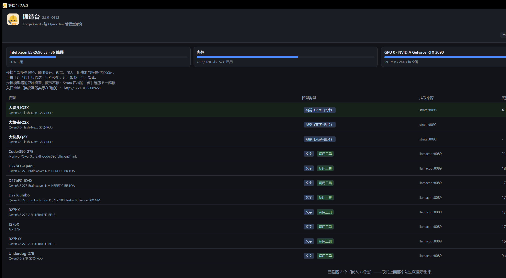
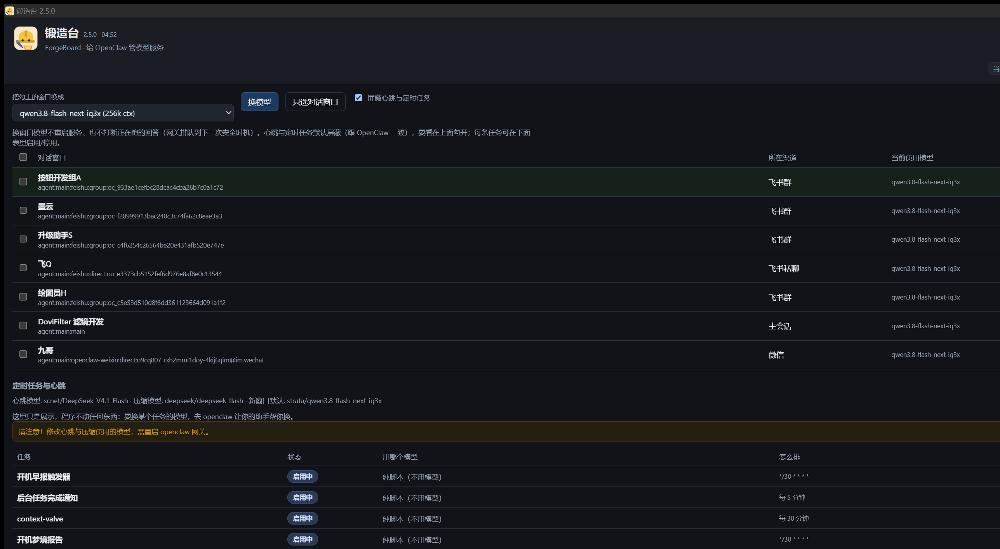
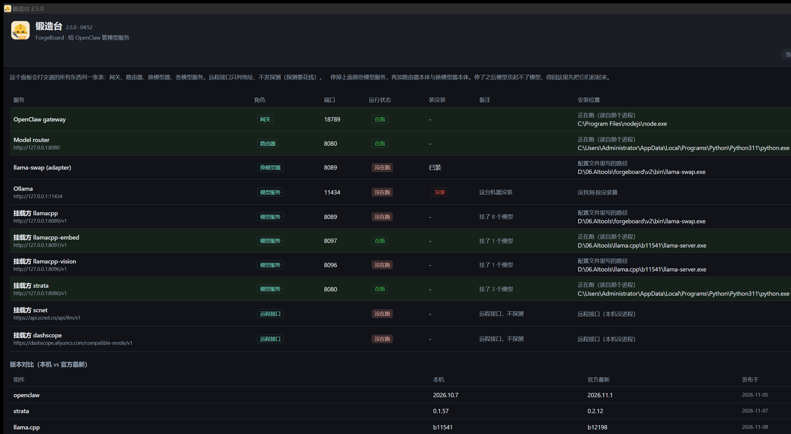
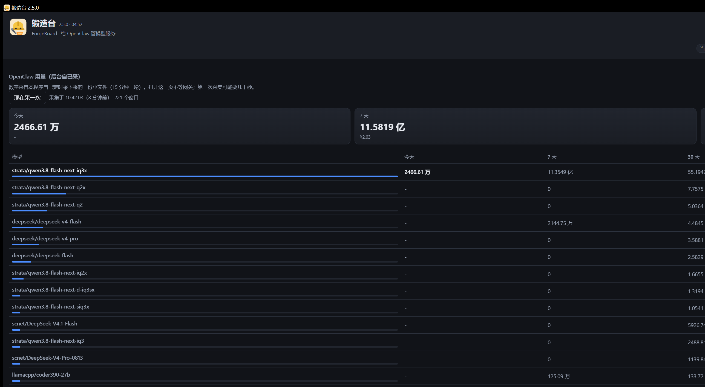

# 锻造台 ForgeBoard

OpenClaw 的模型服务管理面板。Windows 单文件，免安装。

本产品原名**模型服务控制台**（model-console → model-deck，3.x），自 2.x 起更名**锻造台（ForgeBoard）**。
2.x 是同一产品的底层重构：Go 核心 + llama-swap 起停，界面与功能延续 3.x。3.x 冻结在岗，可在 [Releases](https://github.com/ronda2009/forgeboard/releases) 继续下载。

## 功能

- 模型服务起停与档位切换：双显卡分配、显存实测、启动前探测
- 每个 OpenClaw 对话窗口单独指定模型；定时任务、心跳、上下文压缩可各自指定模型
- OpenClaw 用量面板：今日／7 日／30 日用量与花费，按模型分列，后台自采，打开页面不等待网关
- 服务体检：网关、路由器、换模型器、各模型服务，可起停与重启
- 开机计划任务与开机启动项展示，可开关、可删除
- 中英双语界面
- 配置外置，换机自动寻径

## 界面

模型页：档位、显卡、每个模型的挂载来源与集数。



窗口与任务页：给单个对话窗口指定模型，定时任务与心跳所用模型只读展示。



服务页：网关、路由器、换模型器与各模型服务一张表，含端口、运行状态与安装位置。



系统页：OpenClaw 用量面板，今日／7 日／30 日按模型分列。



## 安装

下载 `forgeboard-v2.5.0-windows.zip`，解压后双击 `forgeboard.exe`（界面）或 `forgectl.exe`（命令行）。
未经数字签名，SmartScreen 提示「未知发布者」时：右键 → 属性 → 解除锁定。
从 3.x 控制台升级：直接解压新版即可，旧版数据不受影响；配置为同一个 `forgeboard.json`（3.x 叫 `console-paths.json`），换机自动寻径。

## 命令行

```
forgectl scan | list | start | stop | status | calib | doctor | plan | reload | usage | version
```

## 运行依赖

- PowerShell 7（`pwsh.exe`）
- nvidia-smi（装好 NVIDIA 驱动）
- Node.js（仅运行 `tools/` 下的开发脚本时需要）

模型文件（`.gguf`）不含在包内，由使用者自备。内置 llama-swap（MIT）。

## 打赏 / Buy me a coffee

软件免费。如果它帮你省了时间，可以请作者喝杯咖啡 🙂

<a href="https://qr.alipay.com/fkx13840f42u5aj2vrhkh5c"></a>

扫码或[点这个链接直达付款页](https://qr.alipay.com/fkx13840f42u5aj2vrhkh5c)。
（挂支付宝码而不是 GitHub Sponsors：GitHub 的「支持地区」清单里没有中国大陆。右上角 Sponsor 按钮与这个码是同一个入口。）

## 许可 / License

MIT（见 [`LICENSE`](LICENSE)；[`LICENSE-中文参考.txt`](LICENSE-中文参考.txt) 是非官方中文参考，以英文原文为准）。

## 免责 / Disclaimer

按「原样」提供，无担保。显卡功率、显存、速度都取决于你的机器。用了出事自己担着 🙂

## 下载 / Download

见 [Releases](https://github.com/ronda2009/forgeboard/releases)：

- **2.x 锻造台（现役）**：`forgeboard-v2.5.0-windows.zip`（约 30 MB，界面 exe + 命令行 exe + 示例配置 + README + LICENSE + `SHA256.txt`）
- **3.x 控制台（冻结在岗）**：`model-deck-v31-windows.zip`（约 2 MB，exe + 两份示例配置 + README + LICENSE + `SHA256.txt`）

## 版本 / Versions

见 [CHANGELOG.md](CHANGELOG.md)。
